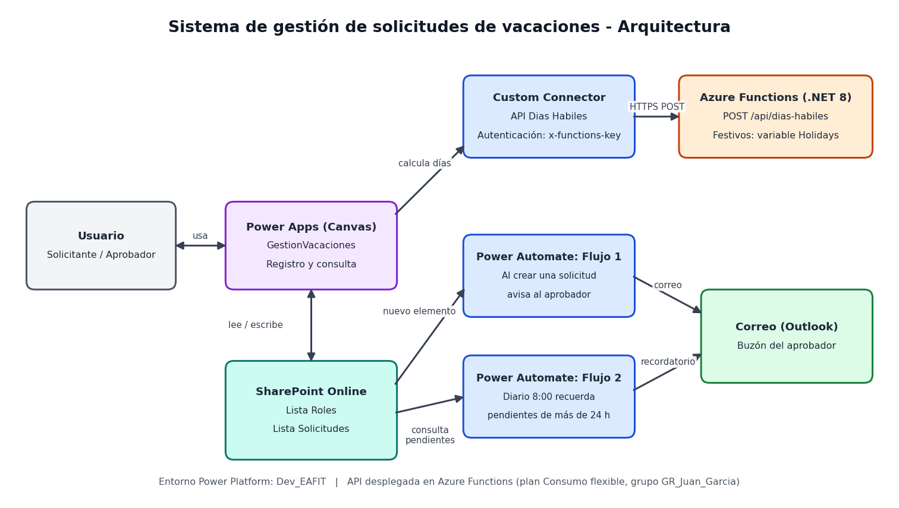

# Sistema de gestión de solicitudes de vacaciones

Reto técnico: Practicante Power Platform ProCode.
Prototipo funcional para una empresa ficticia (Innovatech) que combina **Power Platform** (Power Apps, SharePoint, Power Automate) con una **API REST en C# (.NET 8) sobre Azure Functions** que calcula los días hábiles de cada solicitud.



## Contenido del repositorio

```
.
├── VacacionesApi/                    API REST (Azure Functions, .NET 8 isolated)
├── VacacionesApi.Tests/              Pruebas unitarias (xUnit)
├── solucion-power-platform/          Solución exportada de Power Platform (no administrada)
├── docs/
│   ├── diagrama-arquitectura.png     Diagrama de arquitectura
│   └── capturas/                     Evidencia de las listas de SharePoint y de los flujos
└── README.md
```

## Componentes

### 1. Listas de SharePoint

Sitio: `Reto_tecnico_Juan_Garcia`.

**Roles**

| Columna | Tipo | Uso |
|---|---|---|
| Título | Texto | Nombre de la persona |
| Usuario | Persona | Cuenta del usuario |
| Rol | Opción (`Solicitante`, `Aprobador`) | Define el comportamiento de la app |
| AprobadorAsignado | Persona | Aprobador de ese solicitante |

**Solicitudes**

| Columna | Tipo | Uso |
|---|---|---|
| Título | Texto | Descripción corta de la solicitud |
| Solicitante | Persona | Quien pide las vacaciones |
| FechaInicio, FechaFin | Fecha | Rango solicitado |
| Observaciones | Texto de varias líneas | Comentario libre |
| DiasHabiles | Número | Calculado por la API |
| Aprobador | Persona | Quien debe aprobar |
| Estado | Opción (`Pendiente`, `Aprobado`, `Rechazado`) | Por defecto `Pendiente` |

### 2. API de días hábiles (`VacacionesApi`)

`POST /api/dias-habiles`, con autorización por clave de función (encabezado `x-functions-key`).

Petición:

```json
{ "fechaInicio": "2026-11-02", "fechaFin": "2026-11-07", "festivos": ["2026-11-02"] }
```

Respuesta `200`:

```json
{ "fechaInicio": "2026-11-02", "fechaFin": "2026-11-07", "diasHabiles": 5 }
```

Errores de validación (`400`): `{ "error": "mensaje" }`.

**Reglas de cálculo**

- Se cuentan ambas fechas (inicio y fin incluidos).
- Lunes a sábado son hábiles; los domingos no.
- Los festivos no son hábiles. **No están escritos en el código**: llegan en el campo opcional `festivos` de la petición o, si no se envía, se leen de la variable de aplicación `Holidays` (fechas `yyyy-MM-dd` separadas por coma). Si la petición trae `festivos`, esos tienen prioridad.
- Validaciones: fechas obligatorias y con formato válido, fecha de fin no anterior a la de inicio, rango máximo de 366 días.

**Ejecutar localmente** (requiere .NET 8 SDK y Azure Functions Core Tools v4):

```bash
cd VacacionesApi
func start
```

```powershell
Invoke-RestMethod -Method Post -Uri http://localhost:7071/api/dias-habiles `
  -ContentType "application/json" `
  -Body '{"fechaInicio":"2026-11-02","fechaFin":"2026-11-07","festivos":["2026-11-02"]}'
```

El archivo `local.settings.json` está excluido del repositorio (`.gitignore`). Para pruebas locales debe contener `FUNCTIONS_WORKER_RUNTIME` = `dotnet-isolated` y, opcionalmente, `Holidays`.

**Pruebas unitarias** (11 pruebas: ejemplo del reto, domingos, festivo en domingo, rangos entre meses, fecha final anterior a la inicial y lectura de festivos configurados):

```bash
dotnet test VacacionesApi.Tests
```

**Despliegue en Azure**

- Function App con plan Consumo flexible (Linux, .NET 8 isolated), dentro del grupo de recursos asignado.
- Publicación con Azure Functions Core Tools, ya con la sesión de Azure CLI iniciada:

```bash
cd VacacionesApi
func azure functionapp publish <nombre-de-la-function-app>
```

- En la Function App se define la variable `Holidays`. La clave de función se obtiene en el portal (Claves de la aplicación) y **no se guarda en el repositorio**.

### 3. Power Apps (Canvas App `GestionVacaciones`)

- **Pantalla de registro:** selector de fecha de inicio y de fin, observaciones y botón **Calcular días hábiles**, que llama a la API mediante el Custom Connector. Valida que la fecha de fin sea posterior a la de inicio y muestra un mensaje si la API falla (manejo de errores con `IfError`). El botón **Enviar solicitud** crea el registro en SharePoint con estado `Pendiente` y el aprobador asignado.
- **Pantalla de consulta:** el solicitante ve sus solicitudes y el aprobador ve las solicitudes en las que figura como aprobador (el filtro cambia según el rol leído de la lista Roles). El aprobador puede aprobar o rechazar la solicitud seleccionada.

### 4. Custom Connector (`API Dias Habiles Juan Garcia`)

Conecta Power Apps con la API: esquema HTTPS, ruta `/api/dias-habiles`, método POST y autenticación por clave de API en el encabezado `x-functions-key`.

### 5. Flujos de Power Automate

| Flujo | Disparador | Acción |
|---|---|---|
| **Flujo1 - Notificacion de recepcion** | Al crearse un elemento en `Solicitudes` | Envía un correo al aprobador con los datos de la solicitud |
| **Flujo2 - Recordatorio pendientes** | Programado, una vez al día| Obtiene las solicitudes `Pendiente` creadas hace más de 24 horas y envía un recordatorio al aprobador de cada una |

## Solución exportada

La carpeta `solucion-power-platform/` contiene la solución **SolucionVacaciones** (no administrada) con la Canvas App, los dos flujos y el Custom Connector.

Para importarla: Power Apps → **Soluciones** → **Importar solución**, seleccionar el `.zip` y configurar las conexiones de SharePoint y Outlook. En el Custom Connector hay que indicar la clave de la Function App y, si se despliega la API en otra instancia, actualizar el host.

## Supuestos y decisiones

- **Aprobador asignado:** el reto no define cómo se relaciona un solicitante con su aprobador. Se añadió la columna `AprobadorAsignado` en la lista `Roles`; al registrar una solicitud, la app la copia al campo `Aprobador`.
- **Festivos configurables:** los festivos se pasan en la petición o se leen de la variable `Holidays`. Los valores usados en las pruebas son de muestra y **no están verificados como calendario oficial**.
- **Rango inclusivo:** se cuentan el día de inicio y el de fin. La API acepta rangos de un solo día; la validación "fin posterior a inicio" se aplica en la app, como pide el reto.
- **Usuario de prueba único:** el entorno de evaluación dispone de una sola cuenta, que actúa como solicitante y como aprobador. Para demostrar cada rol se cambia el valor de `Rol` en la lista `Roles`.
- **Notificaciones por correo:** se usa Outlook (Office 365). El aviso al aprobador llega al buzón de la cuenta asignada en `Aprobador`.

## Limitaciones y mejoras pendientes

- Los botones **Aprobar** y **Rechazar** se muestran sin condición por rol: la diferenciación por rol se aplica al filtrar las solicitudes de la galería, pero los botones no se ocultan para los solicitantes. Mejora pendiente: restringir su visibilidad al rol `Aprobador`.
- No se implementó la exportación de solicitudes a Excel o CSV, que el reto contempla como funcionalidad adicional.
- La clave de la función se gestiona manualmente; en un entorno real convendría usar identidad administrada o Azure Key Vault.
